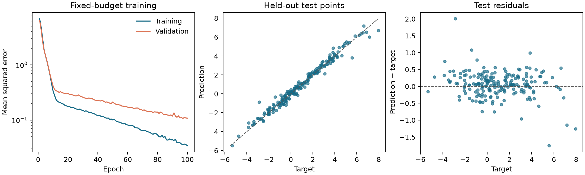
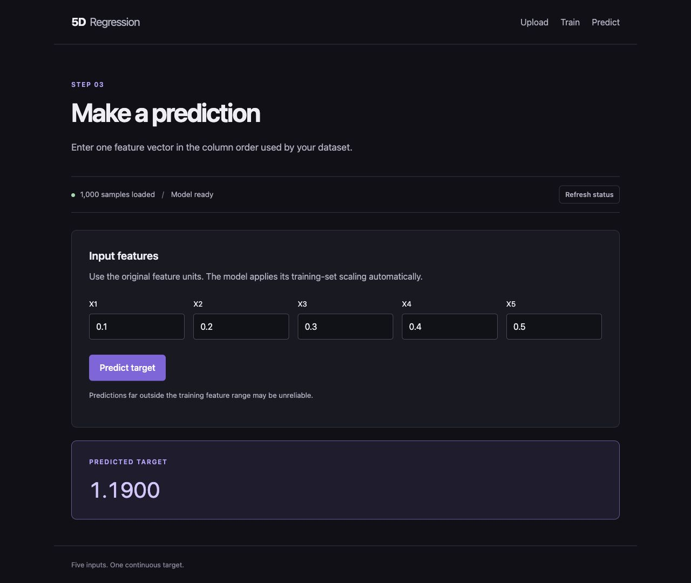

# Five-Dimensional Regression

A web application for fitting a multilayer perceptron to five input features and a scalar target.

**Peijing Pang · Cambridge MPhil in Data Intensive Science · C1 Research Computing coursework (2025)**

The project combines TensorFlow/Keras regression, a FastAPI service and a Next.js interface. Upload a numeric dataset, configure and train a model, inspect split-level metrics, and predict from new feature values. A generated example dataset is included.

## Features

- Configurable ReLU MLP with a linear output, Adam optimisation and MSE loss.
- Reproducible train/validation/test splits and feature standardisation fitted on training data.
- Consistent preprocessing for training and raw-input prediction.
- Browser workflow with input validation, training results and model-state feedback.
- REST endpoints, command-line examples, numerical tests and Docker Compose.
- Sphinx documentation for data, methods, API usage and performance measurement.

## Run locally

Use Python **3.11–3.13** and Node.js **22 or 24**. From the repository root:

```bash
python -m venv .venv
source .venv/bin/activate
python -m pip install -r requirements.txt
python -m pip install --no-deps -e ./backend
uvicorn fivedreg.main:app --host 127.0.0.1 --port 8000
```

In a second terminal:

```bash
cd frontend
npm ci
npm run dev
```

Open **http://localhost:3000**, choose **Upload → Use example data**, then train and predict. The browser communicates through a same-origin API proxy. [RUNNING.md](RUNNING.md) covers production builds, Docker, Python usage and troubleshooting.

With Docker running, the application can also be started with:

```bash
docker compose up --build
```

## Example results

The synthetic target combines quadratic, linear, sinusoidal and interaction terms:

```text
y = x1² + 2 x2 + sin(x3) + x4 x5 + ε
ε ~ Normal(0, 0.1²)
```

The example uses 1,000 observations split into 600 training, 200 validation and 200 test rows. Two hidden layers of 64 nodes are trained for 100 epochs with learning rate 0.001. Data, split and model seeds are each 42.

| Split | MSE | MAE | R² |
|---|---:|---:|---:|
| Training | 0.0327 | 0.1439 | 0.9950 |
| Validation | 0.1083 | 0.2394 | 0.9857 |
| Test | 0.1464 | 0.2695 | 0.9764 |



Metrics use the **final epoch's weights**. Validation is monitored but does not select a checkpoint. These measurements describe the generated function and this configuration, rather than a physical dataset or a general interpolation guarantee. Exact settings and metrics are recorded in [example_summary.json](assets/example_summary.json).

Reproduce the example without starting the web application:

```bash
python -m fivedreg.demo --output-dir outputs/example
```

## Web interface



## Data and API

Datasets are numeric NPZ files containing `X` with shape `(N, 5)` and `y` with shape `(N,)`. Features and targets must be finite. The model uses a training-fitted scaler internally; prediction inputs use the dataset's raw units and column order. Course-provided data are not included. See [Data format](docs/data.rst).

| Endpoint | Function |
|---|---|
| `GET /health` | Check service availability |
| `GET /status` | Inspect dataset, model and training state |
| `POST /upload` | Validate a dataset and start a new session |
| `POST /train` | Train and return metrics, curves and configuration |
| `POST /predict` | Predict one target from five raw feature values |

Interactive API documentation is available at **http://localhost:8000/docs**. The application keeps one dataset and one model in memory for a local user. A valid new upload clears the model; restarting the backend clears the session. Run one backend worker.

## Repository structure

```text
backend/fivedreg/     Data preparation, Keras model, API and synthetic example
backend/tests/        Numerical and API workflow checks
backend/benchmarks/   Timing and Python-allocation measurements
frontend/            Next.js upload, training and prediction interface
frontend/public/     Generated example dataset
assets/              Example figure and metrics
docs/                Sphinx source documentation
```

## Development

```bash
python -m pip install -r requirements-dev.txt
python -m pytest backend/tests
python -m sphinx -W --keep-going -b html docs docs/_build/html
cd frontend
npm run lint
npm test
npm run build
```

Course and software sources are listed in [References](docs/references.rst).
